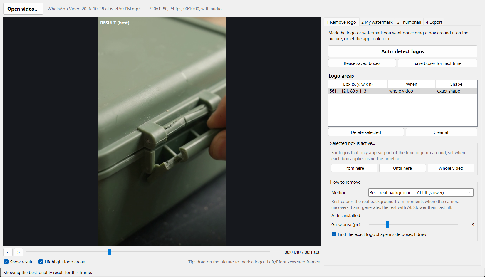
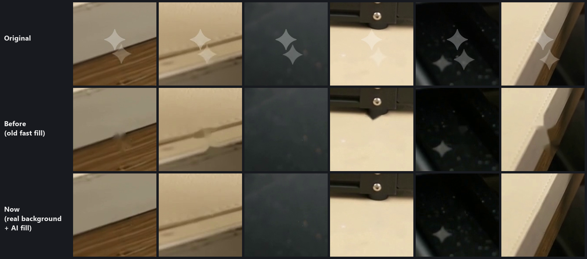

<div align="center">

# ClearMark

**Remove logos and watermarks from video, brand it with your own, and make thumbnails, all locally.**

[](https://github.com/TRAMOX/clearmark/actions/workflows/ci.yml)


[](LICENSE)


[Features](#features) ·
[Quick start](#quick-start) ·
[Usage](#usage) ·
[CLI](#command-line-interface) ·
[How it works](#how-it-works) ·
[Contributing](CONTRIBUTING.md)



</div>

---

## Overview

ClearMark is a desktop and command-line tool for preparing videos for publishing. It finds and removes static logos or watermarks, adds your own text or image watermark, and makes platform-ready thumbnails. Everything runs on your machine: no uploads, no accounts, no cloud processing.

The removal engine is **video-aware**. Most tools paint each frame from the logo's edges, which leaves the smeared or "mirrored" patches visible in the middle row below. ClearMark instead recovers the real background from moments when the camera uncovers it, and fills whatever is never visible with an AI inpainting model.

<div align="center">

<br><sub>Top: original · Middle: conventional per-frame fill · Bottom: ClearMark (real background + AI fill)</sub>
</div>

## Features

| | |
|---|---|
| **Automatic logo detection** | Finds overlays that stay still while the picture changes, including semi-transparent marks, and traces their exact shape. |
| **Video-aware removal** | Copies the real background from neighbouring frames with motion tracking, seam-free brightness blending, and AI fill for areas that are never uncovered. |
| **Temporal stability** | Generated background is created once per shot and moved with the camera, so the result doesn't flicker. |
| **Time ranges** | Each logo area can apply to the whole video or only part of it, which handles logos that jump between positions. |
| **Your watermark** | Text (any installed font, colour, outline, opacity) and/or a PNG logo, in 9 positions, stacked automatically when they share a corner. |
| **Thumbnails** | Picks the best frame automatically (sharpness, exposure, colour), adds a title, and outputs YouTube (1280×720), Shorts/Reels (1080×1920) or square sizes. |
| **Production export** | H.264 via ffmpeg, original audio kept, thumbnail embedded as cover art, original file never modified. |
| **Batch CLI** | Process folders of videos with the same settings you saved in the app. |
| **Presets** | Watermark style, thumbnail style and logo positions are remembered between sessions. |

## Quick start

### Windows

1. Install [Python 3.10+](https://www.python.org/downloads/) and tick **Add python.exe to PATH**.
2. Clone the repository:
   ```bash
   git clone https://github.com/TRAMOX/clearmark.git
   ```
3. Double-click **`run.bat`** in the `clearmark` folder, or drag a video onto it.

The first launch creates a private virtual environment (`.venv`) and installs the dependencies. Later launches start immediately.

### macOS / Linux

```bash
git clone https://github.com/TRAMOX/clearmark.git
cd clearmark
python3 -m venv .venv
.venv/bin/pip install -r requirements.txt
.venv/bin/python app.py
```

Tkinter must be available. On Debian/Ubuntu: `sudo apt install python3-tk`.

### AI fill model (optional, recommended)

The **Best** removal method uses the [LaMa](https://github.com/advimman/lama) inpainting model (ONNX build, 208 MB). Install it once from tab 1 of the app (**Download AI model**), or:

```bash
python cli.py --download-model
```

Without the model, ClearMark still recovers the real background from other frames and falls back to a classical fill for the rest.

## Usage

The app is organised as a four-step workflow.

| Step | What you do |
|---|---|
| **1 · Remove logo** | Click **Auto-detect logos**, or drag a box around the logo on the preview. The exact shape is highlighted in red. Tick **Show result** to compare. Use **From here / Until here** to limit a box to part of the video. **Save boxes for next time** reuses them for videos of the same resolution. |
| **2 · My watermark** | Enter text (for example `@yourchannel`) and/or choose a PNG logo, then set position, size and opacity. |
| **3 · Thumbnail** | **Find best frame** or **Use current frame**, add a title, choose an output size, then **Preview** or **Save**. |
| **4 · Export** | Choose quality and file name, then **Export video**. Progress and remaining time are shown. |

Keyboard: <kbd>←</kbd>/<kbd>→</kbd> step one frame, <kbd>Delete</kbd> removes the selected box.

### Removal methods

| Method | Best for | Speed* |
|---|---|---|
| **Best: real background + AI fill** (default) | Anything that has to look natural | ~1 min per 10 s of 720p |
| **Fast fill** | Quick drafts, small logos on plain backgrounds | ~10 s per 10 s of 720p |
| **Blur** | Hiding a logo rather than removing it | Fastest |

<sub>*Measured on a typical laptop CPU. Most of the Best method's time goes to AI generation, which runs once per shot.</sub>

## Command-line interface

The CLI uses the watermark, thumbnail and export settings last saved in the app as defaults. Any flag overrides them.

```bash
# Auto-detect and remove logos, add a text watermark
python cli.py clip.mp4 --auto --text "@yourchannel"

# Batch a folder into an output folder, with thumbnails embedded as cover art
python cli.py "D:\videos\*.mp4" --auto -o D:\out --thumbnail auto --title "Watch this!" --cover

# Explicit region, active only between 2 s and 6 s, using fast fill
python cli.py clip.mp4 --region 560,1120,90,115@2-6 --method inpaint
```

<details>
<summary><b>All options</b></summary>

| Option | Description |
|---|---|
| `-o, --output` | Output file (single input) or folder |
| `--auto` | Detect static logos automatically |
| `--region X,Y,W,H[@START-END]` | Area to clean in pixels, optionally limited to a time range in seconds. Repeatable. |
| `--saved` | Reuse logo boxes saved in the app for this resolution |
| `--box-only` | Fill whole `--region` boxes instead of detecting the exact shape |
| `--method {smart,inpaint,blur}` | Removal method (`smart` = Best) |
| `--grow N` | Grow logo areas by N pixels |
| `--text`, `--font`, `--text-size`, `--text-color`, `--text-opacity`, `--text-pos`, `--no-outline` | Text watermark |
| `--logo`, `--logo-size`, `--logo-opacity`, `--logo-pos` | Image watermark |
| `--no-watermark` | Don't add any watermark |
| `--thumbnail [SECONDS]` | Save `<name>_thumbnail.jpg` (default: best frame) |
| `--title`, `--thumb-size {youtube,shorts,square,video}` | Thumbnail title and size |
| `--cover` | Embed the thumbnail as the video's cover art |
| `--crf N`, `--preset P`, `--no-audio` | Encoding options |
| `--thumbnail-only` | Make thumbnails without exporting video |
| `--download-model` | Install the AI fill model |

</details>

## How it works

```mermaid
flowchart LR
    A[Input video] --> B[Sample frames]
    B --> C[Detect static overlay<br/>median edge consistency]
    C --> D[Exact logo mask<br/>per-pixel opacity estimate]
    D --> E{For each frame}
    E --> F[Track scenery around the logo<br/>similarity transform, RANSAC]
    F --> G[Copy real background<br/>from neighbouring frames]
    G --> H[Seam-free blending<br/>normalised boundary correction]
    H --> I{Still uncovered?}
    I -- yes --> J[LaMa AI fill<br/>once per shot, carried with camera]
    I -- no --> K
    J --> K[Your watermark]
    K --> L[ffmpeg H.264 + original audio<br/>+ cover thumbnail]
```



1. **Detection.** Frames sampled across the video are compared. A logo's edges point the same way in nearly every frame, while scenery edges come and go, so a low-percentile edge-agreement map isolates static overlays. Inside each candidate box, the per-pixel median of how much each frame is brightened or darkened gives the logo's exact shape and opacity.
2. **Tracking.** For every frame, features around the logo are tracked to the next frame (pyramidal Lucas-Kanade), and a robust similarity transform is fitted. Scene cuts are detected when alignment fails.
3. **Background recovery.** Up to 40 frames on either side are aligned to the current frame. Pixels hidden by the logo now but visible then are copied in, largest-coverage source first to keep seams to a minimum. Sources are only accepted when the surrounding scenery matches once brightness differences are removed.
4. **Blending.** Each copied piece gets a smooth brightness correction spread inward from its border, which avoids visible seams from exposure changes or vignetting.
5. **Generation.** Pixels never uncovered within the window are filled by LaMa. The generated background is stored per shot and warped along with the camera in later frames, and is only regenerated when the scene changes.
6. **Encoding.** Frames are piped to ffmpeg (libx264, yuv420p, `+faststart`). Two decoders run in parallel, one 40 frames ahead, so memory stays constant regardless of video length.

## Project structure

```
clearmark/
├── app.py                    Desktop app (Tkinter)
├── cli.py                    Command-line interface
├── run.bat                   Windows launcher (sets up .venv on first run)
├── requirements.txt
├── vwstudio/
│   ├── media.py              Probing, frame reading, ffmpeg encoding
│   ├── logo_removal.py       Logo detection, shape masks, fast fill / blur
│   ├── smart_fill.py         Video-aware removal (tracking, background recovery, blending)
│   ├── ai_fill.py            LaMa ONNX inpainting and model download
│   ├── watermark.py          Text and image watermark rendering
│   ├── thumbnail.py          Best-frame scoring and thumbnail design
│   ├── pipeline.py           Single-frame and streaming processing, export
│   └── settings.py           Persistent user settings
└── docs/images/              README assets
```

## Requirements

| Component | Version | Notes |
|---|---|---|
| Python | 3.10+ | Tested on 3.14 |
| OpenCV | 4.8+ | `opencv-python` |
| NumPy, Pillow | 1.24+, 10.1+ | |
| onnxruntime | 1.17+ | For the AI fill (CPU) |
| ffmpeg | Any recent | Uses the one on `PATH`, else the bundled `imageio-ffmpeg` binary |

## Responsible use

ClearMark is meant for content you own or are licensed to edit, such as removing your own old branding, cleaning footage you have rights to, or replacing placeholder marks.

- Don't use it to remove attribution or copyright notices from other people's work.
- Removing a visible mark doesn't remove invisible provenance watermarks (for example Google SynthID). Platforms such as YouTube and Instagram require you to disclose realistic AI-generated content. Follow their policies.

## Roadmap

- [ ] GPU acceleration for AI fill (CUDA / DirectML execution providers)
- [ ] Drag-and-drop files onto the window
- [ ] Animated watermark (corner rotation) to discourage cropping
- [ ] Project files (save and restore a whole session)
- [ ] Packaged Windows installer

## Contributing

Contributions are welcome. Please read [CONTRIBUTING.md](CONTRIBUTING.md) before opening a pull request, and report security issues as described in [SECURITY.md](SECURITY.md).

## License

Released under the [MIT License](LICENSE).

## Acknowledgements

- [LaMa: Resolution-robust Large Mask Inpainting with Fourier Convolutions](https://github.com/advimman/lama) (Apache-2.0), using the ONNX export from [Carve/LaMa-ONNX](https://huggingface.co/Carve/LaMa-ONNX)
- [OpenCV](https://opencv.org/), [FFmpeg](https://ffmpeg.org/), [ONNX Runtime](https://onnxruntime.ai/), [Pillow](https://python-pillow.org/)
